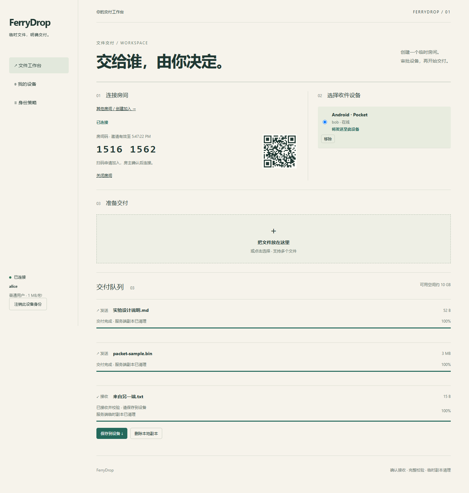
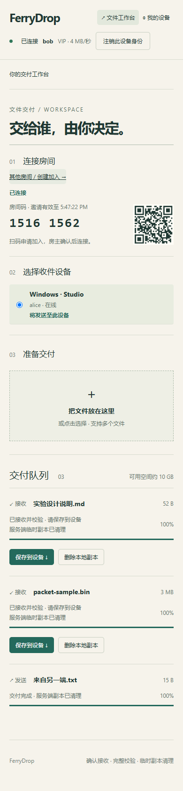
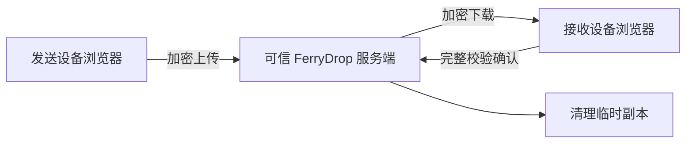

# FerryDrop

扫码配对，确认接收，把文件交给另一台设备。



FerryDrop 是一个自托管的浏览器文件传输工具，也是《软件与系统安全》实验 1B 的实现。设备连接同一个服务端，通过临时房间交换文件，支持多个用户和多个文件同时传输。

- **先确认，再传输。** 房主批准设备加入，接收方确认文件清单，发送端才开始上传。
- **断开后继续。** 上传按服务端确认位置恢复，下载保存在浏览器本地，重新连接后继续接收。
- **交付后清理。** 完整校验后清理服务端副本，浏览器保留文件供用户保存，并显示实际清理结果。

<details>
<summary>查看窄屏界面</summary>



截图来自桌面 Chrome 的窄屏测试，Android 真机测试另行记录。

</details>

## 开始使用

需要 Node.js 24、npm 和 OpenSSL。在仓库根目录执行：

```powershell
npm ci
npm run build
# 换成电脑实际的局域网 IP
npm run cert -- 192.168.1.20
```

将 `certs/ca.pem` 安装到你控制的电脑和手机的受信 CA 存储。访问地址必须与证书匹配；具体步骤见[部署文档](docs/DEPLOY.md)。保管好 CA 私钥，不把它放到手机或运行容器中。

创建账户，口令为 10—256 个字符：

```powershell
$env:FD_USER_PASSWORD = [System.Net.NetworkCredential]::new('', (Read-Host '设置 alice 的密码' -AsSecureString)).Password
npm run user -- alice --tier standard --admin
Remove-Item Env:FD_USER_PASSWORD

# 用相同方式为另一位用户设置独立口令
$env:FD_USER_PASSWORD = [System.Net.NetworkCredential]::new('', (Read-Host '设置 bob 的密码' -AsSecureString)).Password
npm run user -- bob --tier vip
Remove-Item Env:FD_USER_PASSWORD

.\scripts\start.ps1
```

两台设备打开 `https://192.168.1.20:8443`：

1. 使用账户登记各自设备。
2. 一方创建房间，另一方扫码或输入房间码申请加入。
3. 房主批准，选择收件设备并添加文件。
4. 接收方确认，等待校验完成后点击“保存到设备”。

普通用户与 VIP 默认分别共享每方向 1 MiB/s、4 MiB/s 额度，由服务端执行。多个连接和文件仍共享同一账户额度。

## 如何传输



使用 HTTPS/WSS、P-256 设备签名认证、自定义 FNP/1 分块协议和 SHA-256 完整性校验。服务端暂存文件，因此服务端可以读取文件内容。浏览器接收完成后仍需要用户导出保存到设备。

## 开发与验证

```powershell
npm run typecheck
npm test
npx playwright install chromium
npm run test:e2e
```

已安装 Chrome 时可设置 `$env:PLAYWRIGHT_CHANNEL='chrome'` 运行浏览器测试。端到端测试会在回环地址启动隔离服务，自动创建测试账户、传输真实文件并生成 README 截图。

仅本机开发：设置 `FD_INSECURE_LOCALHOST=1` 与 `HOST=127.0.0.1` 后运行 `npm run dev`。该 HTTP 开发模式不用于手机局域网部署。

## 文档

- [启动、证书与最小权限部署](docs/DEPLOY.md)
- [已部署的 Linux 服务器与维护命令](docs/SERVER.md)
- [FNP/1 报头、状态与时序图](docs/PROTOCOL.md)
- [接口约定](docs/INTERFACE.md)
- [验证记录与设备测试边界](docs/VALIDATION.md)
- [实验报告草稿](docs/REPORT.md)与[演示录屏脚本](docs/RECORDING.md)
- [实施计划](docs/PLAN.md)

默认单文件上限 256 MiB。续传要求同一浏览器、同一访问入口且本地站点数据仍保留；上传源文件丢失后需重新选择并核对哈希。手机锁屏可能暂停连接，保持页面前台完成传输。应用连接/消息/配额限制用于缓解资源耗尽，公网带宽洪泛需要网络侧防护。

安卓和 Windows 均使用同一个“保存到设备”按钮，通过浏览器下载文件。保存目录和是否询问位置由浏览器设置决定，接收副本保留到用户主动删除。

Windows 启动与 ACL 脚本、Linux 容器配置位于 `scripts/` 和 `deploy/`。课程提交脚本 `scripts/package.ps1` 接收姓名、学号、真实报告及录屏，按要求生成 ZIP。运行数据、证书私钥和账户口令不会进入源码包。

MIT License。
