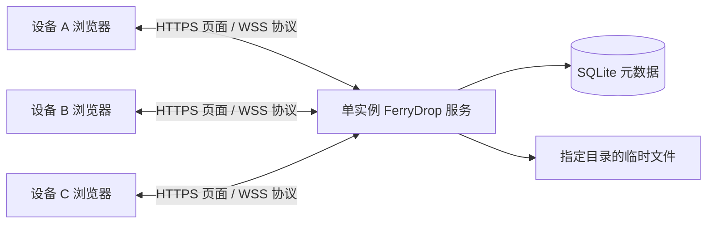

# FerryDrop 实施计划

状态：可运行代码与自动化验证已落地；实际验证见 VALIDATION.md。Android 真机、部署权限实测与最终课程材料仍待完成。

日期：2026-11-10。课程截止：2026-11-24 23:55（北京时间）。

## 1. 产品目标与范围

一句话：在同一网络内，通过浏览器扫码配对，将文件安全交给指定设备；接收方确认，传输可恢复，临时副本自动清理。

仓库名：`ferrydrop`。本地路径：`C:\Users\Administrator\Desktop\Learning Materials\研一\软件系统安全\ferrydrop`。

第一版采用可信服务端暂存与转发，Windows 提供直接启动方式，另提供 Linux 容器部署。所有浏览器连接同一个服务端；安卓之间传输仍需要服务端在线。两段链路均受 TLS 保护，服务端能访问暂存内容，因此不宣称端到端加密。

主要验收设备：Windows Chrome/Edge、Android Chrome。其他浏览器按真实测试记录兼容性；移动端传输期间保持页面前台，后台挂起后通过恢复流程继续。首次使用本地 HTTPS 可能需要安装受信 CA；“免安装客户端”不等于免证书配置。

产品特色：

1. 临时房间：二维码或房间码申请加入，房主审批，邀请可失效。
2. 明确交付：先展示文件清单与发送者，接收方逐项或批量接受后开始上传。
3. 可见结果：展示完整性校验、传输耗时和临时副本清理状态。
4. 临时存储：接收确认后清理服务端内容，取消、撤回、过期均有明确状态。

实现边界：完成课程全部硬要求与四项加分项。第一版采用单实例服务端，暂不加入 WebRTC、跨公网打洞、端到端加密、原生 APP、付费系统或 Kubernetes。

## 2. 课程要求与验收对应

依据上级目录《实验 1 讲解 2026.pdf》：

| 要求 | 页码 | 实现与验收证据 |
| --- | --- | --- |
| 简单但安全的文件传输协议 | 33、46 | 自定义版本化消息、报头、状态机；有正常及错误报文测试 |
| 多用户并发且完整传输 | 33 | 三个独立用户会话并发传输，逐文件 SHA-256 一致 |
| 中间人防护 | 33 | HTTPS/WSS 正确校验证书；不受信或身份不符的证书不能用于认证传输 |
| DDoS 等攻击防护 | 33 | 连接、认证、报文、上传配额和带宽限制；受控压测后仍能处理正常请求 |
| SQL 注入防护 | 33 | 所有数据库输入参数绑定；注入字符串不能绕过身份和权限 |
| 持久连接与 keep alive | 36—37 | WSS 长连接复用，服务端常驻，心跳/超时/重连；连续传两个文件不主动断开 |
| 协议报告 | 36—37 | 每个协议模块的时序图、报头图、长度/字节序、异常与终态解释 |
| 文件系统访问控制 | 45 | 应用路径授权 + 服务账户/容器权限配置，交付脚本及越权失败证据 |
| 断点续传（加分） | 40 | 上传和下载中断后从已确认的连续偏移恢复，服务重启后仍可查询任务 |
| 公钥身份验证（加分） | 40 | 浏览器设备私钥签名、服务端绑定公钥验签；挑战重放失败 |
| GUI 同时上传下载多个文件（加分） | 40 | 多任务队列同时显示双向进度、暂停/继续、取消，网络记录证明真实并发 |
| 按用户身份控制带宽（加分） | 40 | 普通/VIP 策略在服务端执行；多连接无法绕过用户总额度 |
| 源码、演示、报告与 Git 记录 | 2—3、33 | Windows 构建/部署/测试演示，完整源码、报告与仓库地址，ZIP 提交 |

应用内限流针对连接与资源耗尽，报告分别给出测试负载和结果；超出入口带宽的洪泛需要网络侧防护。把这一边界写在安全评估中。

## 3. 技术方案

| 层 | 选择 | 用途 |
| --- | --- | --- |
| 仓库 | npm workspaces + TypeScript | 前后端共享协议类型，单仓库构建 |
| 前端 | React + Vite + 原生 CSS | 响应式界面、文件队列与设备状态 |
| 服务端 | Node.js 24.x + Fastify + WebSocket 插件 | HTTPS 页面/API、WSS 认证与文件传输 |
| 数据库 | SQLite，优先 Node 内置 `node:sqlite` | 用户、设备公钥、房间、任务和持久化偏移 |
| 文件与哈希 | 服务端流式文件 I/O；浏览器 Worker 增量 SHA-256 | 避免整文件载入内存；保持界面响应 |
| 浏览器持久化 | IndexedDB 保存密钥/元数据；OPFS 保存接收分块 | 刷新后的设备认证与传输恢复 |
| 安全 | TLS、Web Crypto ECDSA P-256、服务端 scrypt | 通信保护、设备签名认证、初次账户凭据 |
| 测试 | 单元/集成测试 + Playwright | 协议、权限、恢复、并发及界面主流程 |
| 部署 | Windows PowerShell + Linux Docker Compose | Windows 主验收路径与进程隔离演示 |

落地时锁定实际依赖版本并提交锁文件。先用本机 Node 24.15.0 验证 SQLite、WSS 和构建最小链路，不凭计划宣称库稳定性或性能。



页面与 WSS 同源，避免额外跨域部署。HTTPS 仅承担页面、引导与会话等常规请求；文件数据与传输控制走持续 WSS。

## 4. 身份、配对与权限

### 4.1 账户和设备公钥

- 管理员通过本地 CLI 创建用户，设置普通/VIP 身份；不在仓库放默认口令或固定管理员密码。
- 用户首次通过受信 HTTPS 进行账户认证，浏览器生成不可导出的 ECDSA P-256 私钥，保存至 IndexedDB，只将公钥登记给账户。
- 公钥登记必须依赖已验证的账户会话；新增、撤销设备需要近期重新认证。私钥不传给服务器。
- 日常认证使用一次性挑战：签名内容绑定协议版本、服务身份、账户、设备、连接会话、随机挑战和有效期。验签后立刻消费挑战，拒绝跨会话或重复使用。
- 签名序列化与编码在协议中固定；明确 Web Crypto 和 Node 的 ECDSA 签名表示，编写互操作测试。
- 新设备用自己的账户完成认证后再扫码申请进房；房间码只用于配对，不代替用户身份验证。
- 清除浏览器站点数据会丢失设备私钥，必须重新登记；管理员能撤销旧设备。非导出私钥也不能替代 XSS 防护。

### 4.2 房间与交付

- 创建房间，生成 8 位临时邀请码；二维码将房间码放在 URL fragment，页面读取后清除。邀请码只用于申请，不能代替认证与审批；限制有效期与请求频率。
- 房主审批加入申请，设备标签仅用于显示，真正授权关联已验证的用户与设备 ID。
- 每个文件指定一个接收设备；群发用独立交付任务，第一版不做多接收者共享同一份临时副本。
- 接收方先看到文件名、大小和发送设备；接受后才允许发送端上传文件数据。
- 每次查询、发块、收块、恢复、撤回均校验任务归属、房间成员关系和状态。移除成员时立即失去继续传输的权限。
- 认证绑定 WSS 连接，不使用持久会话 cookie；校验 WSS Origin，管理操作在已认证连接中执行。文件名只作文本渲染，采用 CSP，传输内容不执行、不预览活动内容。

## 5. 应用层协议与连接维护

协议暂名 `FNP/1`，使用 WSS 子协议标识。WebSocket 保证消息边界，自己定义业务报头和数据语义。

控制消息使用 JSON，至少包含 `version / type / requestId / body`。错误返回稳定错误码、关联请求 ID 和可读说明；不得把服务端堆栈、路径或凭据发给客户端。

数据消息采用固定 32 字节二进制头 + 原始字节载荷，单块初始上限 256 KiB：

| 偏移 | 长度 | 字段 |
| --- | --- | --- |
| 0 | 1 | version |
| 1 | 1 | type |
| 2 | 2 | flags |
| 4 | 16 | transferId（UUID 原始字节） |
| 20 | 8 | offset（无符号，大端） |
| 28 | 4 | payloadLength（无符号，大端） |

接收时验证实际长度、任务权限、偏移、配额和状态；超大整数拒绝转换为不安全 JS Number。报头放在 WebSocket 消息内，不把它当作 TCP segment，也不以关闭连接代表文件结束。

模块：

1. `AUTH_CHALLENGE / AUTH_PROOF / AUTH_OK`：公钥认证。
2. `ROOM_CREATE / JOIN_REQUEST / JOIN_DECIDE / MEMBER_REMOVE / ROOM_CLOSE`：房间与成员。
3. `FILE_OFFER / FILE_ACCEPT / FILE_REJECT`：交付协商。
4. `CHUNK / ACK / CREDIT`：分块、连续确认偏移、流量窗口。
5. `UPLOAD_FINISH / READY / DOWNLOAD_FINISH / RECEIVED`：上传校验就绪、接收校验确认。
6. `PAUSE / RESUME_QUERY / RESUME_STATE / CANCEL`：恢复和取消。
7. `HEARTBEAT / HEARTBEAT_ACK / ERROR / STATUS`：保活及状态。

连接维护：服务端启用 TCP keepalive 和 WebSocket ping/pong，另有浏览器可见应用心跳；避免以心跳承诺手机后台常驻。超时标记离线，重连使用有上限的退避；重新认证后查询状态。窗口内复用同一 WSS 连接，多个 transferId 交错传输。

每连接限制排队字节数、在途块数和最大报文；应用信用窗口与 WebSocket bufferedAmount/服务端 drain 结合，慢接收端不能造成无限内存积压。

## 6. 续传、完整性和清理

### 6.1 传输模型

先完成上传暂存与服务端 SHA-256 校验，再允许接收方下载。文件按服务端生成的 ID 存储，客户端文件名不能拼接成磁盘路径。

任务状态：`OFFERED → ACCEPTED → UPLOADING → READY → DOWNLOADING → RECEIVED → CLEANED`。暂停/断线保留可恢复偏移，取消、过期、失败有明确分支。所有终态变更具有幂等语义，断线重发完成确认不会重复副作用。

### 6.2 上传恢复

- 服务端只对完成写入并满足恢复持久性策略的连续前缀确认偏移；DB 与文件之间定义写入顺序及重启对账流程。
- SQLite 同步操作保持短小；按有界检查点合并恢复元数据提交，检查点内数据可靠写入且元数据提交后才能确认。避免每个数据包反复同步刷盘阻塞事件循环，检查点窗口纳入背压限制。
- 重启时核对暂存文件长度、已确认偏移及校验信息，截断未确认尾部；文件短于已记录偏移时回退到可验证检查点并明确告知客户端。
- 恢复时服务端为偏移权威；重发数据不得追加两遍，越界或跳跃偏移拒绝。
- 刷新后浏览器可能需要用户重选源文件；通过完整文件哈希、大小匹配任务，不能只比文件名。
- 断线后的增量哈希不能假定能序列化；恢复时流式重读已保存前缀或重新计算整个文件校验值。

### 6.3 下载恢复

- 接收分块写入 OPFS，持久化已写入偏移后发送 ACK；恢复时核对本地文件长度与任务记录。
- 开始接收前调用存储配额估算并尝试申请持久存储，捕获空间不足；刷新恢复限于同浏览器、同源且站点数据仍然存在的情况。
- 完整 SHA-256 一致后发送 `RECEIVED`；页面区分“完整接收并校验”与“已导出保存”。
- OPFS 保存不等于文件已经进入手机“下载”目录；最后仍需用户触发浏览器导出保存。
- 第一版以支持 OPFS 的验收浏览器实现完整续传；不支持或配额不足时给出明确提示。普通 Blob 导出路径设置可配置文件大小上限，初始目标 256 MiB，经真机测试调整并记录。
- 校验过程中使用 Worker 和增量读取，避免以一次 arrayBuffer/digest 承载大文件。支持桌面流式保存 API 时可增强导出，不让其成为 Android 必需条件。
- 站点存储可能被用户清除或浏览器回收，无法恢复时明确重新下载；证书、域名、端口变更涉及同源存储，部署文档固定访问入口。

### 6.4 生命周期

- 邀请有效期、房间有效期和任务保留期分别配置；邀请过期不删除已授权任务。
- 房间自然到期停止新加入和新交付；此前已授权任务在各自保留期内仍可恢复。暂停任务在保留期内可恢复。
- 房主主动关闭房间时撤销成员访问并取消关联未完成任务；操作前明确提示其后果。成员主动撤销与自然到期采用不同状态。
- 到期任务先停止收发、持久化终态，再关闭文件句柄并清理，处理 Windows 文件占用导致的删除失败。
- 已接收并校验的任务清理服务端副本；保留最少回执元数据用于展示状态，不存完整用户路径和文件内容。
- 清理失败标记“待清理”并有限重试，不能提前显示“已删除”；重启扫描遗留临时文件并对账。
- 页面关闭或应用退出时清理浏览器接收临时文件的时机需与导出流程协调；保留尚未导出的已校验内容并允许用户主动删除。
- 删除是正常文件删除，不宣称物理安全擦除；已保存到接收设备的文件无法远程撤回。

## 7. 并发和按身份限速

- GUI 支持多任务选择、上传与下载同时进行、逐项/批量暂停和取消。
- 服务端按用户 ID 聚合所有连接的流量，分别配置上传、下载速率和突发容量；普通/VIP 由服务端账户属性决定。
- 上传使用服务端分配的信用窗口和限速调度；不按客户端自报的等级或 JS 定时延迟信任限速。
- 下载发送前取令牌；上传在信用发放、读入处理和暂存写入路径控制，恶意越窗发送受限或断开。
- 同一用户多任务采用轮转，受限用户不阻塞其他用户；控制消息和心跳保留小额独立预算。
- 测试网络足够快且文件足够大时，比较两个身份的持续速率；排除握手、哈希和短时突发，报告实际测量窗口、阈值与误差。

## 8. 安全与部署

- TLS 信任方案在第一条真实设备链路前验证。局域网以本地 CA 签发含访问域名/IP SAN 的证书，分别配置 Windows 与 Android 信任；不能采用忽略证书错误的验收路径。
- CA 私钥仅由证书生成工具访问，不部署到服务端、不提交 Git。服务端仅获得自身证书与私钥；文档写明根证书的安装和移除步骤。
- SQLite 全部使用参数绑定，动态排序字段仅允许白名单。
- 文件路径采用服务端 ID、固定存储根、规范化校验并禁止跟随外部符号链接/重解析点；任何任务 ID 都必须经过归属校验。
- 对认证失败、入房尝试、并发连接、消息速率、单块/单文件大小、用户与全局磁盘额度分别设限；未认证连接有短超时。
- 提供 Windows 专用低权限运行账户/ACL 配置脚本，区分程序只读、配置/证书只读、runtime 可写；不修改课程父目录或用户整个桌面的 ACL。
- Linux 容器使用非 root 用户、只读根文件系统、受控 data 挂载、必要 tmpfs 和能力收缩。用进程级越权写入测试证明配置生效。
- 客户端可访问的内容只来自受控文件存储。进程仍需要读取运行库和配置；应用路径校验不能替代系统级权限隔离。
- 日志记录任务 ID、动作、结果和必要时间，不记录口令、会话 cookie、邀请密钥、私钥或文件内容。Git 忽略运行数据和密钥。
- Windows 原生部署为主要验收路径；容器作为额外隔离与复现实验，不要求用户先搭建集群。公网 Linux 部署仅在本地功能完成且需要跨网络演示时采用。

## 9. Web UI 视觉方向

遵循 distinctive-ai-design：探索三个不同构图，再以一个代表性页面验证。

| 概念 | 构图与隐喻 | 字体/交互 | 适配 |
| --- | --- | --- | --- |
| A. 纸面渡口（默认） | 留白工作台，上方房间/设备，中央待交付文件，侧栏收件确认 | 清晰中文无衬线，数字等宽；文件像待签收便笺，动作围绕“交给谁” | 桌面双栏，手机顺序单栏 |
| B. 传输调度台 | 深色高密度列表，按发送/接收分轨，持续展示速率与队列 | 紧凑字号、快捷操作；强调多任务调度 | 桌面优先，手机收起次要列 |
| C. 双页对投 | 两侧设备构成对称画面，文件从发送侧进入接收侧 | 大按钮、较少文字；强调两设备配对与方向 | 配对体验强，多用户时需切换设备 |

默认采用 A，原因是扫码、接收确认与临时交付能共享同一个视觉隐喻，多文件队列也有足够空间。

Brief：用户是需要在电脑和手机间临时交换文件的人；目标感受是轻巧、清楚、可控。暖白背景 `#F6F3EB`、墨色文字 `#203833`、深青主按钮 `#24695C`、朱红警示 `#B74532`；实际对比度需检查。系统中文无衬线为正文，等宽字体仅用于房间码、文件大小与速率。细分隔线和折角/交付方向提示作为重复线索，避免堆叠卡片、技术名词标语和装饰性仪表盘。

代表性页面：房间工作台。覆盖未连接、等待加入、待确认、传输中、断线恢复、校验成功、清理失败八种状态；首屏主动作随状态变化，移动端主要按钮保持易触达。

界面模块：入口/账户认证、创建/加入房间、设备列表与审批、文件选择与接收确认、多任务队列、传输结果、设备密钥与身份策略设置。管理能力只对管理员展示。

视觉验收：真实浏览器桌面和窄屏截图；焦点/键盘、文本对比、长文件名、零字节文件、错误提示、减少动态效果。独立设计评审只接收截图、任务与 brief；最多两轮，每轮修最影响使用的 1—3 项，再截图核对。

## 10. 仓库与文档

预期目录：

```text
ferrydrop/
  apps/server/          # 认证、房间、传输、限速、清理
  apps/web/             # 界面、设备密钥、浏览器接收与恢复
  packages/protocol/    # 报头编解码、消息类型、状态约束
  tests/               # 集成、安全、恢复、端到端测试
  scripts/             # 证书、Windows 启动/ACL、打包
  deploy/              # 容器与示例配置
  docs/                # 计划、协议、安全、部署、实验报告
  assets/readme/       # 真实截图、确定性示意图
  README.md
```

README 采用整页模式：项目名与一句话用途 → 真实双端截图 → 首次成功传输步骤 → 三个产品特色 → 简明工作流程 → 安装/证书配置 → 已测兼容性与安全边界 → 详细文档链接。技术细节放进文档。采用 Markdown 标题、真实截图及必要的纯 SVG 架构示意，不加入装饰性大横幅或动画。按 beautify-github-readme 读取对应制作参考，检查 900px/360px 显示效果并执行 audit_readme.py；截图未产生前不伪造界面或完成状态。

文档按 stss 写作：直接说明行为、机制、验证和实际限制，不重复宣传安全性。README 不代替课程报告。

报告至少包含：场景与需求、技术取舍、完整协议头图、认证/配对/协商/上传/下载/续传/清理/异常时序图、状态机、正确性说明、安全模型与访问控制、全部加分项、实际测试环境与结果、部署复现、Git 地址。报告最终导出 PDF/DOCX 时使用对应文档技能渲染检查。

演示视频覆盖：源码构建、启动和证书配置说明、Windows/Android 真机互传、安卓之间互传、多用户多任务双向并发、公钥认证、断线续传、身份限速、安全拒绝案例、到期清理。录屏脚本随实现形成，视频必须来自实际运行。

提交打包脚本读取姓名和学号参数，按课程规则生成源码目录、视频和报告的 ZIP；缺少材料时指出缺项，不生成看似完整的最终提交包。

## 11. 实施顺序与完成条件

日期是排期目标，按完成条件推进；实现中持续维护勾选状态。

| 阶段 | 目标时间 | 工作 | 完成条件 |
| --- | --- | --- | --- |
| P0 设计与可信链路 | 11/10—11/11 | 仓库、协议约定、最小 HTTPS/WSS、证书与密钥兼容性实验 | Windows/Android 受信页面、长连接心跳、公钥签名互验、OPFS 配额/导出验证 |
| P1 核心传输 | 11/12—11/14 | 账户/设备、房间审批、接收确认、分块上传下载、权限隔离 | 两端双向传输及校验；拒绝未授权收发；连接复用 |
| P2 全部加分项 | 11/15—11/17 | 持久化续传、多文件双向调度、按用户限速、设备撤销 | 断线/重启恢复、多文件并发、普通/VIP 比较与防多连接绕过 |
| P3 产品界面与生命周期 | 11/18—11/19 | 纸面渡口界面、二维码、窄屏、回执、清理、取消 | 真机核心操作、边界状态、两轮内截图评审 |
| P4 安全与部署 | 11/20—11/21 | 负载限制、注入/路径/权限测试、Windows ACL、容器 | 必需测试通过，真实进程权限生效，启动文档可复现 |
| P5 展示与提交 | 11/22—11/23 | README、协议/报告、录屏、打包 | 截图真实、报告图齐全、视频完整、ZIP 结构校验 |
| P6 截止前复核 | 11/24 | 干净目录复现、材料/Git 地址核对、提交 | 23:55 前完成课程网站提交 |

任务清单：

- [ ] P0：本机可信 TLS、P-256、OPFS 与导出自动化完成；Android 真机可信链路待验证。
- [x] P1：协议包、用户/设备、房间与权限、端到端文件交付。
- [x] P2：上传下载恢复、多文件双向并发、公钥撤销、聚合身份限速。
- [x] P3：正式 UI、二维码配对、状态反馈、生命周期与浏览器真实截图（不代替手机真机）。
- [ ] P4：安全/权限/资源测试、Windows 与容器部署复现。
- [ ] P5：README、报告、演示视频与提交脚本。
- [ ] P6：真实设备验收、完整 Git 记录、最终打包与课程网站提交。

## 12. 测试策略和证据

只编写验证真实契约、失败模式与课程要求的测试，不为静态文案和 CSS 实现镜像测试。

| 测试组 | 必测场景 |
| --- | --- |
| 编解码 | 截断/超长消息、非法版本/长度/偏移、未知类型、二进制边界 |
| 身份 | 公私钥不匹配、重放/过期挑战、未授权公钥登记、撤销设备 |
| 授权 | 非成员、伪造用户 ID、跨用户 transferId、未经接受发块、成员移除后续传 |
| 完整性 | 零字节、中文/长文件名、二进制、跨块边界、不同大小、哈希不一致 |
| 恢复 | 上传/下载断网、刷新、服务重启、ACK 丢失、重复块、写入与 DB 更新之间终止 |
| 并发 | 三用户、同连接双向多文件、多个连接同用户、慢接收端背压 |
| 限速 | 普通/VIP 上传和下载、总额度、多文件公平性、心跳在限速下可用 |
| 清理 | 接收后删除、暂停未到期保留、到期取消、Windows 占用、重启对账、重复确认 |
| 攻击与资源 | SQL/路径注入、HTML 文件名、恶意 Origin、连接/认证洪泛、报文和磁盘配额 |
| 权限 | 受限身份能够写 runtime，不能写其他测试目录；客户端不能访问配置/密钥 |
| UI/设备 | 桌面/窄屏主流程、键盘焦点、错误状态；两台安卓真机传输单独记录 |

性能作为测量项记录吞吐、内存、CPU、用户数和测试文件大小，不预设“高速”数字。手机浏览器模拟不能替代 Android 真机证据；无法获得真实设备时明确标注待验证。

## 13. 协作与交付规则

按 team-mode 进行有边界的分工：先冻结共享协议，主代理维护协议与整合；前端、后端或独立评审按独立写入目录委派。没有独立任务时单代理推进。提交代码前做限定范围的简化与审查，问题回归通过后结束验证。

本地仓库先建立在用户指定目录。远程仓库采用同名，后续结合已登录账号建立，保留真实分阶段 Git 历史。远程发布与权限设置单独记录，不把本地 init 当作已开源；课程允许提交后公开。

按 stop-that-shit：实现全部承诺功能；新增机制必须对应上述功能、威胁或验收。不会用新增架构替代已知问题的修复。测试通过且必需证据齐备后交付。

下一步在 Android 真机验证受信 HTTPS、扫码和下载保存，随后完成低权限部署实测与最终报告、录屏。

## 14. 技术参考

- 课程依据：上级目录《实验 1 讲解 2026.pdf》，重点第 2—3、33—46、65 页。
- [RFC 6455：WebSocket](https://www.rfc-editor.org/rfc/rfc6455)：双向连接、消息与 WSS。
- [Node.js 24 SQLite 文档](https://nodejs.org/download/release/v24.20.0/docs/api/sqlite.html)：内置数据库 API；实现时按安装版本核对。
- [Web Crypto generateKey](https://developer.mozilla.org/en-US/docs/Web/API/SubtleCrypto/generateKey)：密钥生成、ECDSA 和安全上下文。
- [OPFS](https://developer.mozilla.org/en-US/docs/Web/API/File_System_API/Origin_private_file_system)：浏览器源私有存储，不等同于用户下载目录。
- [浏览器配额与回收](https://developer.mozilla.org/en-US/docs/Web/API/Storage_API/Storage_quotas_and_eviction_criteria)：浏览器存储的恢复边界。
- [OWASP 文件上传指南](https://cheatsheetseries.owasp.org/cheatsheets/File_Upload_Cheat_Sheet.html)：受控存储、授权和资源限制。

