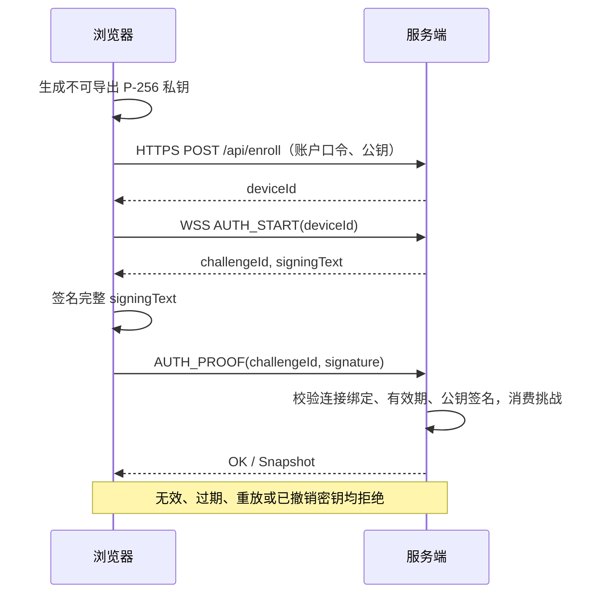
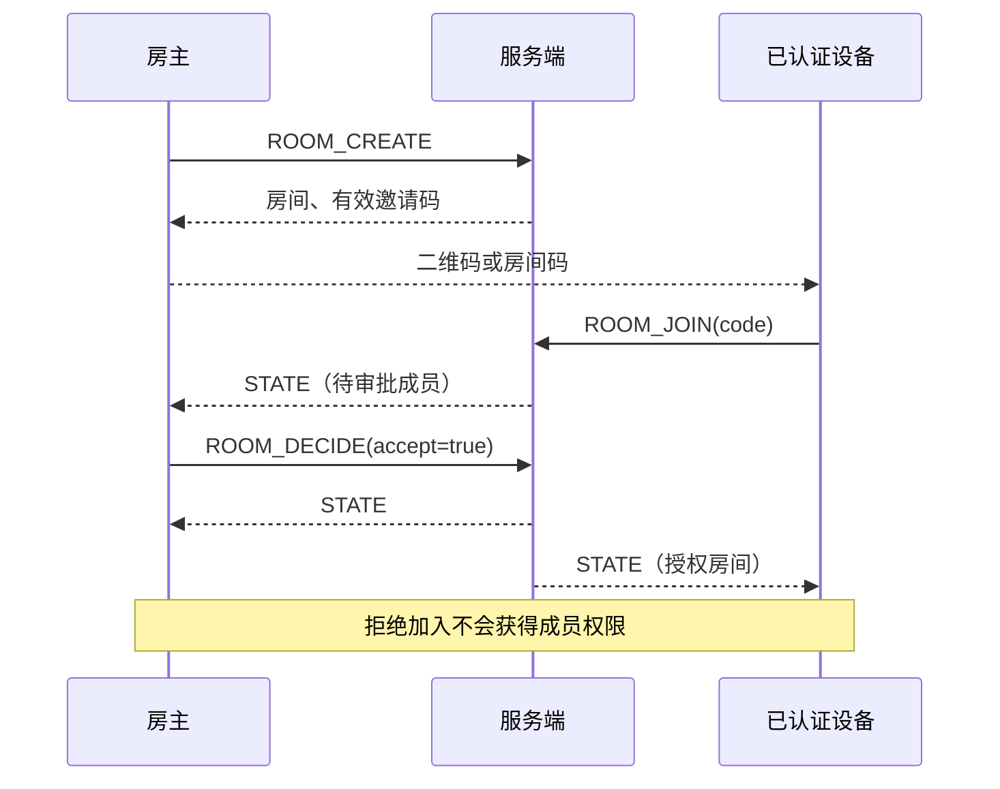
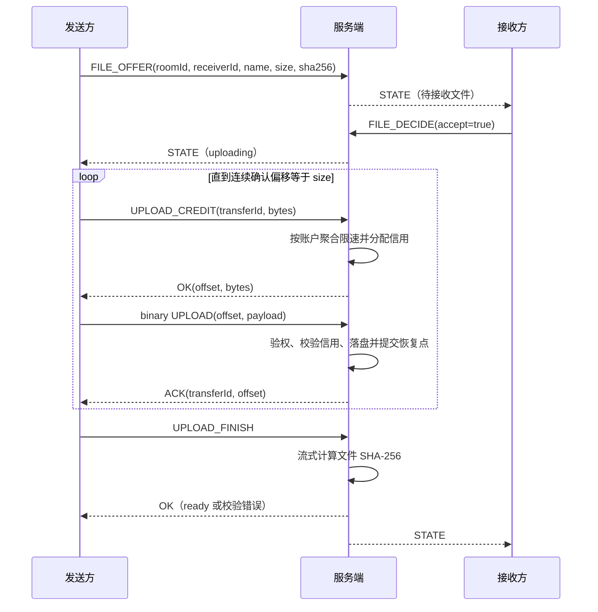
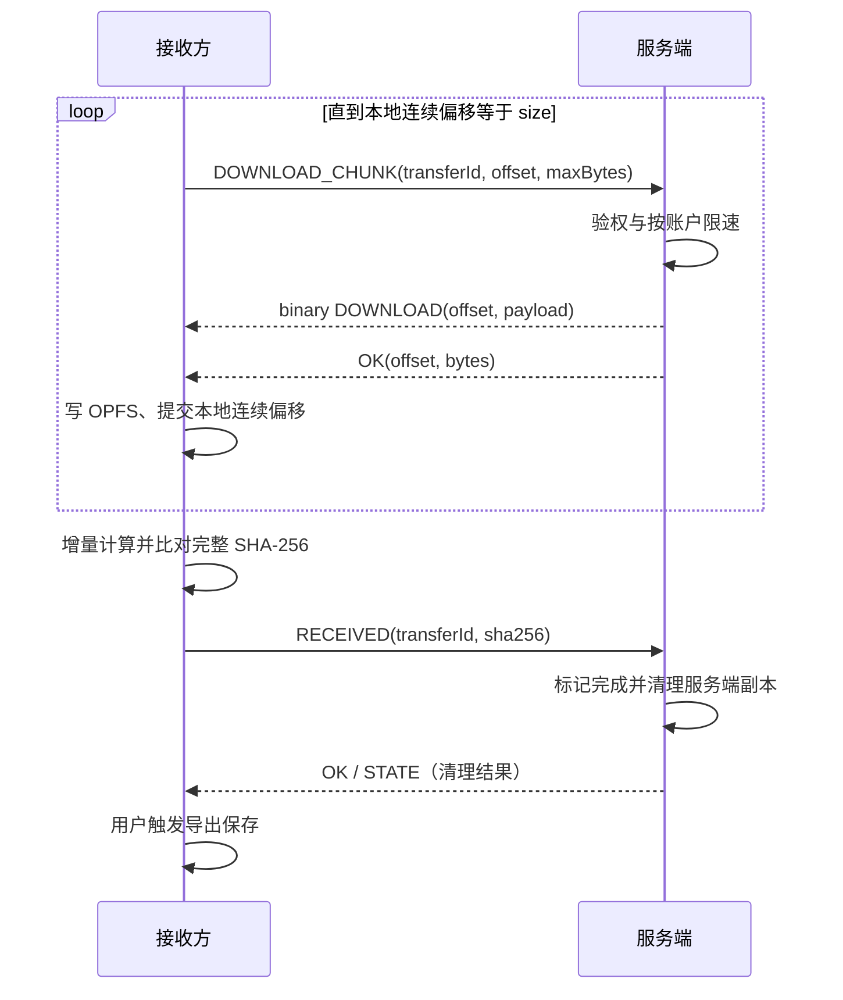
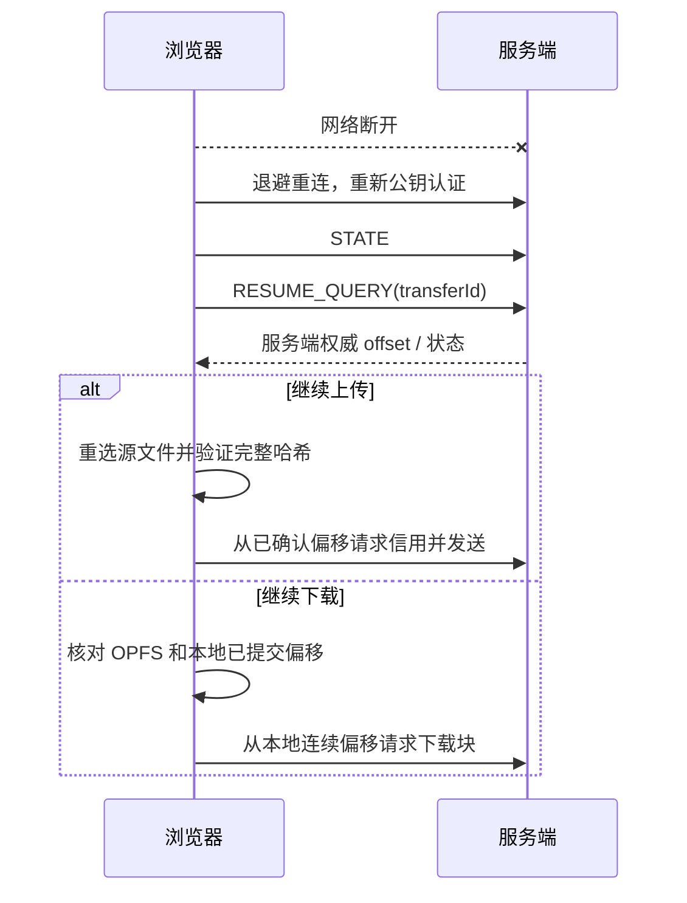
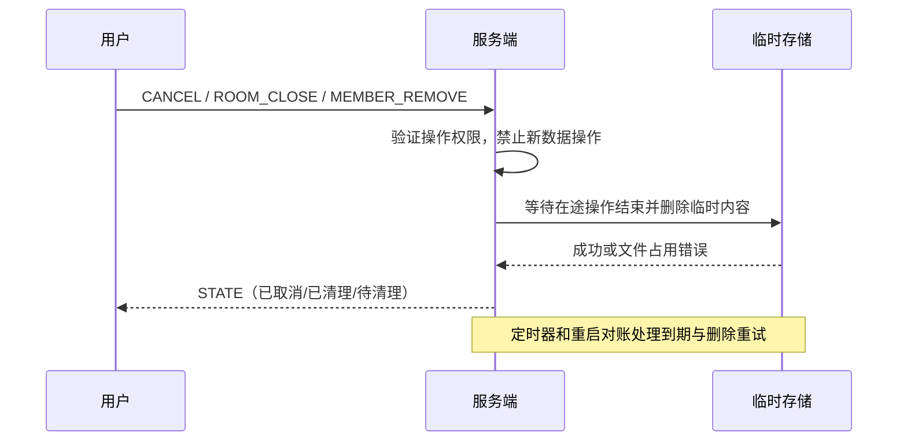
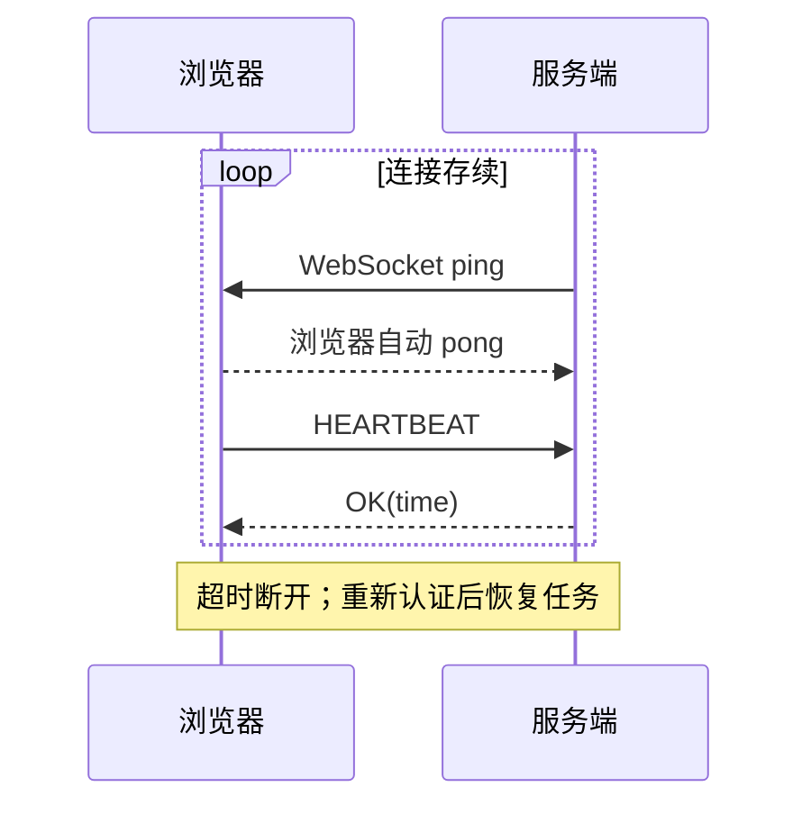

# FNP/1 应用层协议

FerryDrop 在 TLS 保护的 WebSocket 上运行 FNP/1。生产入口为同源 `wss://<host>:8443/ws`，WebSocket 子协议为 `ferrydrop.v1`。TLS 负责链路保密、完整性和服务器身份；FNP/1 负责用户/设备认证、房间授权及文件交付。服务端是可信暂存方。

## 消息与报头

控制消息为 UTF-8 JSON：`{v:1,id,type,body}`。请求 ID 关联 `OK` 或 `ERROR` 响应，事件不带请求 ID。错误体包含 `code` 和 `message`。控制消息上限 16 KiB。

数据消息为固定 32 字节报头与最多 256 KiB 原始字节。一个 WebSocket 消息对应一个数据块；载荷不使用 Base64。

```text
bit   0       8       16              32
      +-------+-------+---------------+
      | v = 1 | type  | flags = 0     |  4 bytes
      +-------+-------+---------------+
      | transferId : UUID            | 16 bytes
      +-------------------------------+
      | offset : uint64 big-endian    |  8 bytes
      +-------------------------------+
      | payloadLength : uint32 BE     |  4 bytes
      +-------------------------------+
      | raw payload                   |  0..262144 bytes
      +-------------------------------+
```

`type=1` 为上传、`type=2` 为下载。UUID 以 16 字节存储。偏移不得大于 JavaScript 安全整数上限，且不能越出任务文件长度。实际消息长度必须等于 `32 + payloadLength`。未知版本、类型、非零保留位和不一致的长度均拒绝。报头编解码由 `packages/protocol` 共用。

## 1. 设备登记与认证

账户由本地管理员创建。首次登记用受信 HTTPS 校验口令并绑定设备公钥；后续持有 IndexedDB 私钥的设备通过一次性签名挑战认证。P-256/SHA-256 签名使用 IEEE-P1363 原始 `r || s` 表示，再以 Base64 放入 JSON。



挑战不能跨连接使用，签名材料由服务端原样给出，客户端不得自行拼接不一致版本。登记操作本身也必须被授权，不能把“提交了一个公钥”当成账户身份。

## 2. 房间与成员



邀请码只定位申请，服务器身份和成员审批共同决定访问权。扫描二维码后仍需要已认证设备身份。`MEMBER_REMOVE` 撤销成员后，后续传输和恢复请求也要重新检查成员资格。

## 3. 文件协商和上传



未接受文件时不能取得上传信用。文件使用服务端生成的任务 ID 存储，文件名只用于显示。零字节文件也必须协商，但无需发块。完成信号与连接关闭无关，下一文件继续复用 WSS。

## 4. 下载、校验与回执



“接收并校验完成”代表内容已完整进入浏览器临时存储。是否进入用户下载目录由最后的导出操作决定。服务端清理后，本地临时文件仍应保留到用户完成导出或主动删除。

## 5. 断线、暂停与恢复



暂停停止请求新块或信用；在途操作有界地结束。上传恢复以服务端确认位置为准，下载恢复以接收方本地实际保留的连续内容为准。服务端重启先核对文件和数据库，未确认尾部不能冒充已接收。浏览器源文件句柄丢失时需要重新选择；浏览器站点数据被清除时不能承诺恢复已下载内容。

## 6. 取消、过期与清理



邀请、房间和任务有独立到期时间。房间自然到期停止新加入与新任务；任务是否可恢复由已有授权及其保留期决定。主动关闭房间则取消未完成交付。删除失败不能显示为已清理。

## 7. 保活、并发与身份限速



同一个连接允许多个 transferId 交错。上传按信用接收，下载按请求响应，限制每块大小及连接缓存。用户上传/下载预算分别聚合，开多个连接仍共享账户总额度。应用控制消息另行限制频率，不能被大文件流量无限阻塞。

## 正确性与失败结果

1. 大小和连续偏移决定文件边界，完整 SHA-256 检查内容，不使用 TCP FIN 判断完成。
2. 任务归属、房间权限和状态在每个操作检查，知道任务 ID 不代表获权。
3. ACK 仅确认可恢复的前缀，重连从该前缀继续，避免丢块或重复追加。
4. 完成、取消和清理要能承受重复请求和进程重启；成功回执不能早于对应操作完成。
5. 消息体、数据帧和磁盘额度有上限，错误由关联响应返回；连接级严重错误可断开并由恢复流程处理。

精确 RPC 字段与共享类型见 [INTERFACE.md](INTERFACE.md) 和源码。部署、证书和测试证据分别记录，不将此协议说明视为测试通过的证据。
