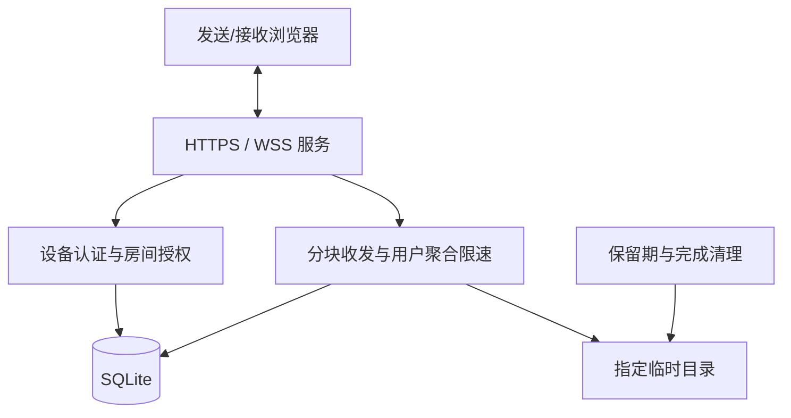
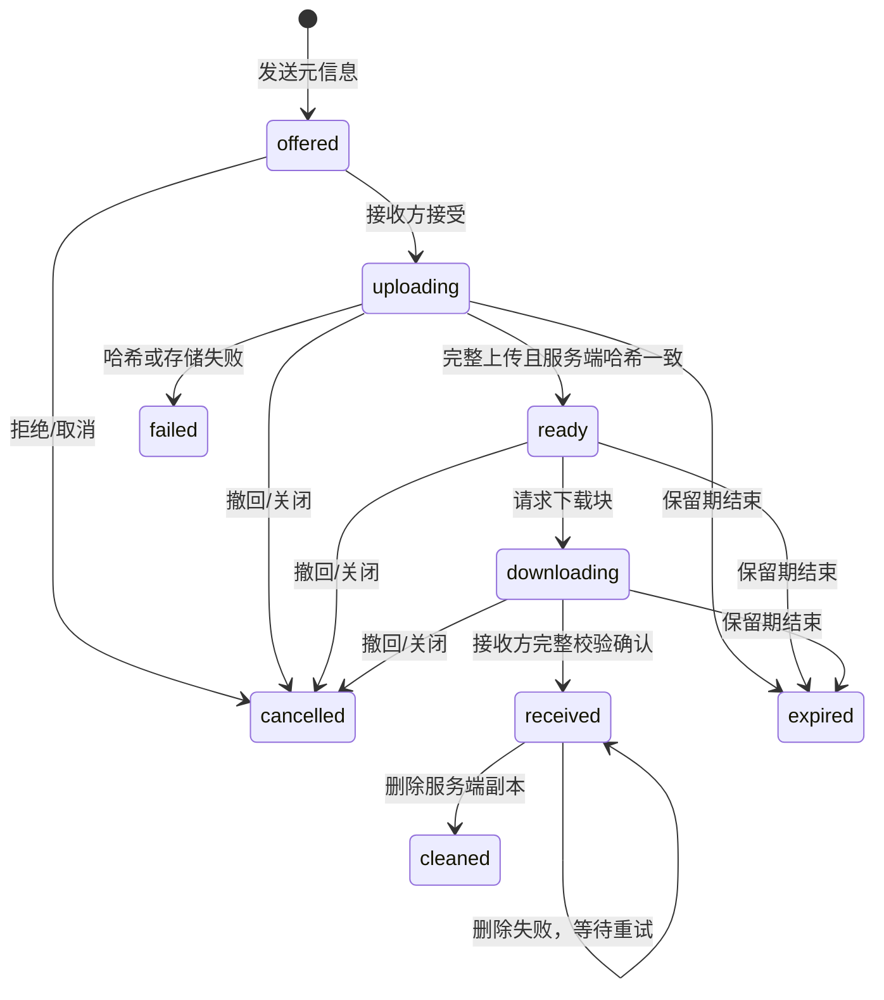

# FerryDrop：安全文件传输软件设计与实现

实验 1B 报告草稿。姓名、学号、Git 地址和真机测试记录在最终提交前补充；本文记录当前实现，图示与测试结果可用于最终报告排版。

## 需求与目标

在同一网络中，用浏览器完成跨设备临时文件交付。用户需要明确知道文件交给谁、接收方是否同意、文件是否完整，以及临时副本是否清理。服务端支持多个用户，客户端在文件完成后继续保持连接。

实现覆盖断点续传、公钥身份验证、GUI 双向多文件并发和按用户身份限速四项加分要求。Windows 为主要服务端入口，浏览器前端覆盖桌面与窄屏布局。

## 系统设计

React 前端通过 HTTPS 获取页面，通过 WSS 运行 FNP/1 协议。Node.js 服务端负责账户与设备、公钥挑战、房间审批、文件分块、完整校验、限速和清理。SQLite 保存身份和恢复元数据，指定目录保存以 UUID 命名的临时文件。

采用可信服务端转发，使设备不需要开放入站端口，也便于统一实现权限与带宽策略。服务端可以读取暂存内容，TLS 分别保护两端到服务端的链路。

## 应用层协议

控制消息为带版本和请求 ID 的 JSON，二进制数据为 32 字节固定报头加原始载荷。报头包含版本、类型、保留位、任务 ID、偏移和载荷长度，整数采用大端。最大分块为 256 KiB。

完整报头图与各模块时序图见 [PROTOCOL.md](PROTOCOL.md)，包括设备登记/认证、房间审批、文件协商/上传、下载/回执、恢复、清理与保活；精确消息参数见 [INTERFACE.md](INTERFACE.md)。

文件大小与偏移确定消息边界，不以关闭 TCP 连接判断完成。服务端定期 ping，浏览器自动 pong，应用心跳用于页面状态；连接异常后重新认证并恢复任务。

## 安全实现

设备首次通过账户口令登记公钥；后续使用不可导出 P-256 私钥对一次性挑战签名。服务端固定曲线、编码与有效期，挑战绑定当前连接及服务身份，用后消费。撤销设备使后续认证和数据操作失败。

房间码只触发加入申请，房主批准后获得房间权限；每份文件必须由指定接收设备接受。所有任务操作再次校验设备、成员关系、发送/接收身份和状态。文件名不作为存储路径，数据库使用参数绑定。页面采用 CSP 和文本渲染，WSS 检查 Origin。

对未认证连接、请求速率、在途请求、帧长度、单文件大小、暂存额度和连接缓存设置限制。普通与 VIP 的上传/下载预算各自按用户 ID 聚合，增加连接不能增加总额度。网络带宽层面洪泛需要部署环境提供防护。

Windows ACL 与 Linux 只读容器配置见 [DEPLOY.md](DEPLOY.md)。应用路径隔离与进程权限隔离分别处理，脚本的存在不代替实际权限测试。

## 恢复与完整性

上传信用限定本次可发送的数据量，服务端完整写入、同步和提交偏移后才 ACK。恢复以服务器确认偏移为准，未确认尾部在启动对账时截断。接收方在 OPFS 保存文件并提交本地偏移，再请求下一块；恢复时核对本地实际长度。

前端用 Worker 增量计算整文件 SHA-256，服务端流式复核，接收完成后再次校验。上传源文件在刷新后可能需要重新选择，不能仅凭文件名恢复。接收成功后保留浏览器副本供用户导出，服务端清理结果单独展示。

## 实验验证

当前环境、执行命令、通过结果和未验证项见 [VALIDATION.md](VALIDATION.md)。自动化覆盖协议边界、多用户权限、公钥重放、分块与整文件校验、正常及强制进程重启恢复、聚合限速、生命周期、TLS 信任与服务身份、真实浏览器双向多文件交付。

正式提交前补充 Windows/Android 真机互传、安卓之间互传、受限服务账户测试、实际限速对比和录屏。兼容性只按实际设备与浏览器版本填写。

## 构建与复现

从仓库根目录执行 npm ci、npm run build，生成匹配局域网地址的证书并让测试设备信任 CA，创建用户后启动。具体命令见 [README](../README.md) 和 [DEPLOY.md](DEPLOY.md)。

演示脚本见 [RECORDING.md](RECORDING.md)。最终报告需附真实 Git 地址；使用 scripts/package.ps1 按姓名与学号组织源码、报告和 MP4，生成未加密 ZIP。
